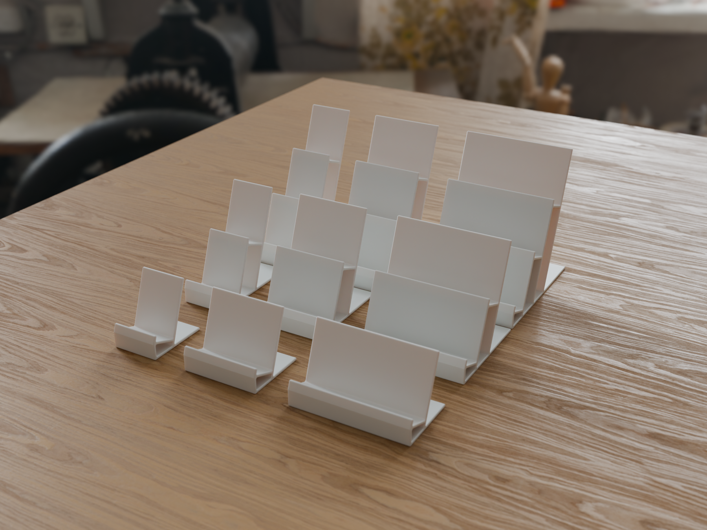
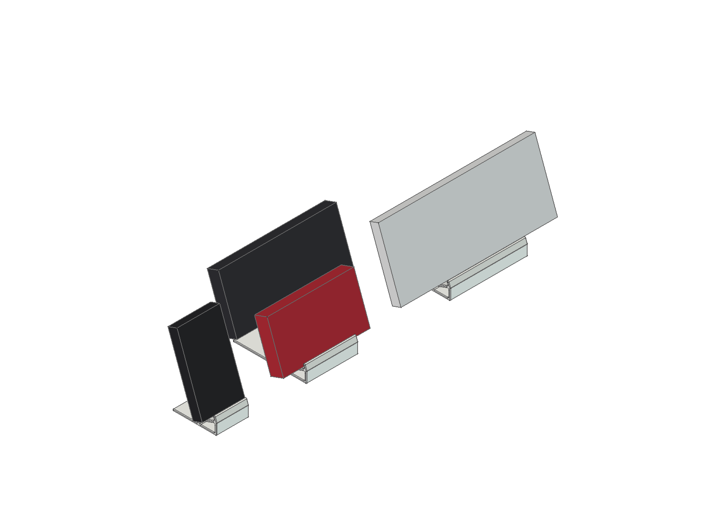
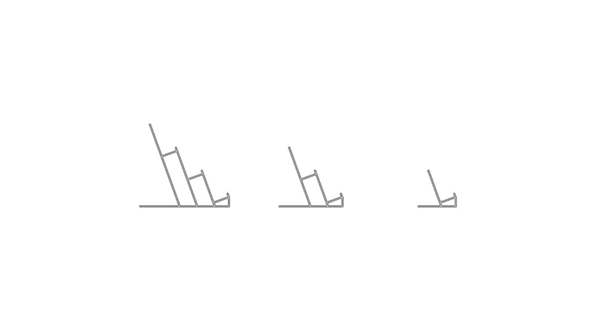
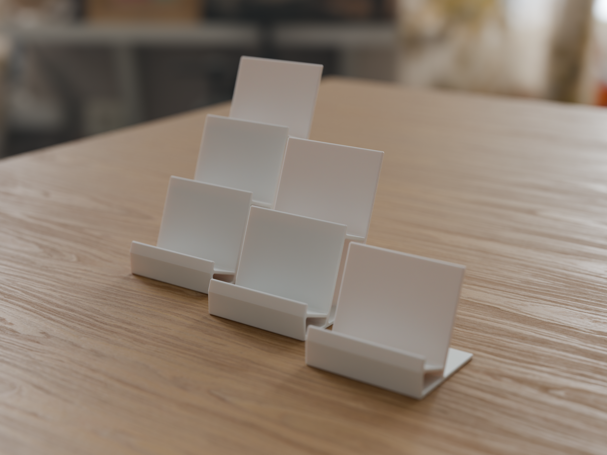
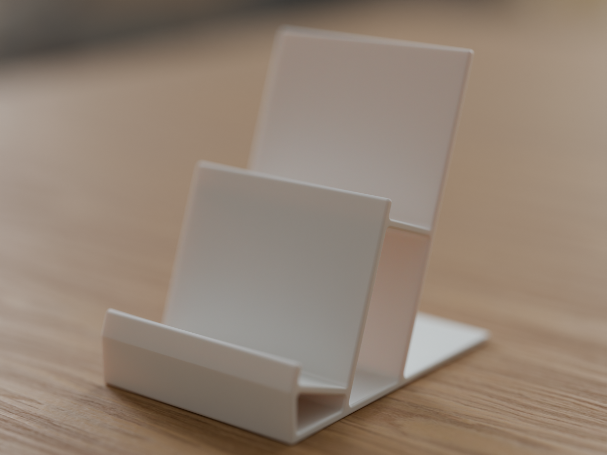
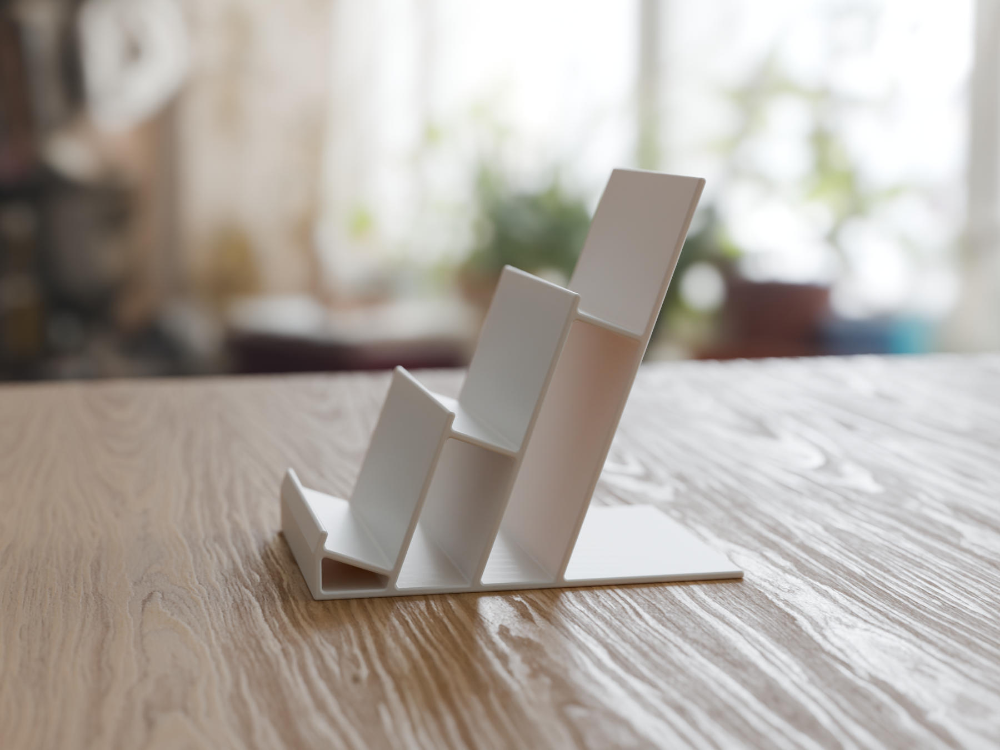

# Tiered Handheld Display Stand: 1N to 3W

A display stand family for handheld consoles and old phones, standing closed: PSP, PS Vita,
PSP Go, 3DS, DS Lite, Miyoo Mini, Switch, Switch Lite, Switch OLED, Retroid Pocket 4,
BlackBerry Bold and anything else up to 23 mm thick. One, two or three tiers, three widths.
In the two and three tier stands each device sits about 41 mm higher than the one in front,
so every screen stays in view.

Designed in FreeCAD as one parametric script (`build_stand.py`). Prints on its side with
no supports.

## Variants

Named `<tiers><width>`: **N** narrow 50 mm, **M** medium 80 mm, **W** wide 120 mm.

| Variant | Tiers | Width | Size D × W × H (mm) | PLA | Time (K1) |
|---|---|---|---|---|---|
| 1N | 1 | 50 | 68 × 50 × 66 | 33 g | 46 min |
| 1M | 1 | 80 | 68 × 80 × 66 | 53 g | 1 h 11 min |
| 1W | 1 | 120 | 68 × 120 × 66 | 80 g | 1 h 43 min |
| 2N | 2 | 50 | 114 × 50 × 107 | 67 g | 1 h 24 min |
| 2M | 2 | 80 | 114 × 80 × 107 | 107 g | 2 h 11 min |
| 2W | 2 | 120 | 114 × 120 × 107 | 160 g | 3 h 12 min |
| 3N | 3 | 50 | 160 × 50 × 148 | 108 g | 2 h 9 min |
| 3M | 3 | 80 | 160 × 80 × 148 | 173 g | 3 h 21 min |
| 3W | 3 | 120 | 160 × 120 × 148 | 259 g | 4 h 57 min |

Weights and times are from OrcaSlicer for a Creality K1 (0.4 mm nozzle, 0.2 mm layers,
3 walls, 20 % infill). The 3 mm walls come out nearly solid at these settings.

## Which width

| Width | For | Device (W × H × D mm, closed) |
|---|---|---|
| N, 50 mm | phones and small portrait devices | BlackBerry Bold 66 × 114 × 15, Miyoo Mini Plus 78.5 × 108 × 22 |
| M, 80 mm | DS family, PSP family, Vita, Retroid | DS Lite 133 × 74 × 21.5, 3DS 134 × 74 × 21, PSP-1000 170 × 74 × 23, PSP Go 128 × 69 × 16.5, PS Vita 182 × 83.5 × 18.6, Retroid Pocket 4 184 × 81 × 16 |
| W, 120 mm | Switch family | Switch 239 × 102 × 14, Switch OLED 242 × 102 × 14, Switch Lite 208 × 91 × 14 |

Device sizes are approximate public figures. The ledge takes any device up to 23 mm thick at its
bottom edge; wider devices simply overhang the stand on both sides.

## Geometry

| | |
|---|---|
| Lean | 20° back from vertical |
| Ledge | 26 mm deep, square to the back plate, so devices slide into the corner |
| Front lip | 6 mm |
| Back plate | 60 mm above the ledge on the top tier |
| Tier step | about 41 mm up and 46 mm back |
| Walls | 3 mm |
| Edges | 1.4 mm round on the profile, 1.0 mm round on the top side face, 0.8 mm 45° chamfer on the bed side face |

The side profile zigzags: the back plate of each tier rises into the front lip of the tier behind
it, and every back plate also runs down to the base.

## Stability

Table tilt needed to tip a loaded stand over, worst case over these loads: every tier loaded,
front tier only, rear tier only, and each listed device alone on the top tier, all with the
heaviest device of the width class (Miyoo Mini Plus, PSP-1000, Switch OLED).

| Variant | Forward | Backward |
|---|---|---|
| 1N | 31.0° | 26.9° |
| 1M | 33.3° | 36.2° |
| 1W | 34.2° | 28.9° |
| 2N | 36.7° | 24.6° |
| 2M | 39.3° | 28.2° |
| 2W | 39.0° | 24.3° |
| 3N | 40.6° | 26.0° |
| 3M | 42.7° | 27.5° |
| 3W | 42.2° | 24.9° |

Backward is the weak direction because devices lean back. `build_stand.py` prints this table on
every run.

## Printing

- **Orientation:** on its side, as the STLs come. The chamfered side face goes on the bed.
  Every layer is the whole profile, so there are no overhangs or bridges and the back plates
  are as strong as the material allows.
- **Material:** PLA or PETG.
- **Settings:** 0.2 mm layers, 3 walls, 15–20 % infill, no supports. A 5 mm outer brim helps
  the tall W variants; the N and M variants print fine without one.

## Files

| Path | What |
|---|---|
| `build_stand.py` | The whole design. Run inside FreeCAD (`exec(open("build_stand.py").read())`) or headless with `freecadcmd build_stand.py`. All dimensions are parameters at the top. |
| `stl/stand-*.stl` | Print-ready STLs, already on their side |
| `step/stand-*.step` | STEP files, standing upright |
| `slice_k1.sh` | Slices every variant for a Creality K1 with generic PLA into `gcode/k1-pla/` (not in the repo), plus `test-1M+2M_PLA.gcode` with 1M and 2M on one plate. Needs OrcaSlicer. |
| `profiles/k1_stand_process.json` | OrcaSlicer process used for the G-code |
| `stand.FCStd` | FreeCAD document with all nine variants |
| `images/` | `render-*.png` product renders, numbered PNGs are FreeCAD views |
| `render/render_stands.py` | Blender (Cycles) scene for the renders: run `blender -b -P render/render_stands.py`; HDRI and oak texture are CC0 from Poly Haven, in `render/assets/` |

To add a device thicker than 23 mm, raise `LEDGE`. To add a width, add an entry to `WIDTHS`.

## Printables listing

- **Title:** Tiered Handheld Display Stand: PSP, Vita, 3DS, Switch, Retro Phones (1–3 tiers)
- **Summary:** Parametric display stand family for handheld consoles and old phones. 1, 2 or 3 tiers
  in three widths; rear devices sit higher. Prints on its side, no supports.
- **Category:** Video Games
- **Tags:** handheld, stand, display, psp, vita, 3ds, ds, switch, miyoo, retroid, blackberry,
  console, retro, shelf, parametric, freecad
- **Licence:** to be decided before upload
